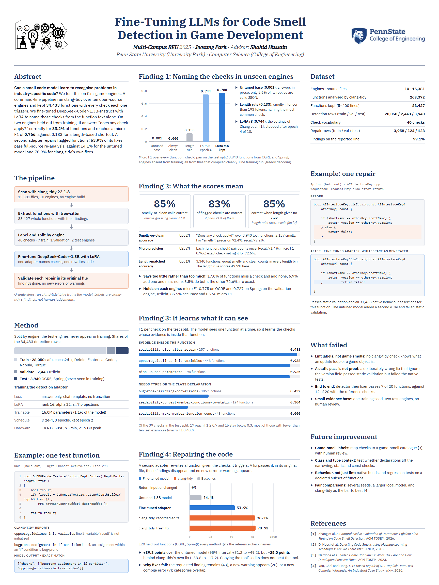

# C-FineTuneDeepSeek

Research question: can a small code model learn to recognise industry-specific code patterns? The test case is code smells in C++ game engines.

The project fine-tunes [`deepseek-ai/deepseek-coder-1.3b-instruct`](https://huggingface.co/deepseek-ai/deepseek-coder-1.3b-instruct) with QLoRA into two adapters:

- **Detection** — given a C++ snippet, output the smells found as JSON.
- **Fixing** — given a snippet (and detected smells), output refactored code and explanations as JSON.

## Poster



## Status

The work was done in July 2025 and paused. An audit in October 2026 found that the 2025 adapters did not learn the intended task and that no evaluation produced a valid score. The causes were in the dataset and the training setup, and are documented with measurements in [docs/AUDIT.md](docs/AUDIT.md). The notebook and the scripts under `src/inference/` belong to that 2025 work.

Since then:

- **New data.** [docs/COLLECTION.md](docs/COLLECTION.md) describes a command-line pipeline that scans the engine sources with clang-tidy and produces a detection dataset (34,433 functions) and a fixing dataset (25,245 pairs), split by engine.
- **A working detection adapter.** [docs/TRAINING.md](docs/TRAINING.md) describes the fine-tuning run on the new detection data. On two engines held out from training it reaches 85.2% accuracy on "does any check apply" and a micro F1 of 0.766 over the individual checks, against 56.7% and 0.133 for a length-based baseline. The reference labels are clang-tidy's findings, not human judgements.
- **Repair pilot.** [docs/FIXING.md](docs/FIXING.md) describes the new fixing adapter, a local repair demo, and independent full-source static validation. [Measured results](docs/FIXING_RESULTS.md) compare the model with the base model and tool controls. This is a restricted pilot; static passes do not establish behavioral correctness or paper readiness.
- **Not done:** labels have not been mapped to game-specific smells.
- **Cleaned 2025 data.** [docs/DATASET.md](docs/DATASET.md) describes what could be salvaged from the original data, and why its labels are weak.

## Repository layout

```
notebooks/
  DeepSeek_Coder_1.3B_FineTuned.ipynb   main notebook: data prep, training, merging, evaluation
  scratch/                              early experiments (LoRA smoke test, saved cells)
src/
  training/train_lora.py                LoRA fine-tuning on the collected data
  evaluation/evaluate_detection.py      scores a model on the collected detection data, with baselines
  evaluation/advanced_evaluation.py     2025 metric code (detection P/R/F1, fixing BLEU/ROUGE)
  inference/                            2025: three stand-alone inference scripts for the old adapters
  testing/simple_test.py                2025: quick load-and-generate check
scripts/
  collect/                              new data collection: clang-tidy scan -> functions -> datasets
  build_clean_dataset.py                rebuilds and verifies data/clean/detection from the 2025 data
  audit/                                scripts behind the numbers in docs/
  plot_architecture.py                  draws the pipeline diagram
docs/
  poster.png                            research poster of the October 2026 results
  AUDIT.md                              findings and recommended next steps
  COLLECTION.md                         the new collection pipeline: how to run it, what it produces
  TRAINING.md                           fine-tuning on the collected data: setup, scoring, results
  DATASET.md                            the cleaned 2025 detection dataset: format, use, label quality
  RELATED_WORK.md                       reading list on detecting code smells with language models
  DeepSeek_Coder_1.3B_FineTuned.html    static export of the main notebook
results/
  collected_detection/                  metrics and predictions of the October 2026 runs
  figures/                              2025: loss curves and sample outputs
  evaluation_csvs/                      2025: per-example outputs from early evaluation runs
  inference_results/                    2025: metrics from the last evaluation run (all zero, see audit)
requirements.txt                        2025 training and notebook environment
requirements-collect.txt                collection pipeline; installs clang-tidy, needs no PyTorch
requirements-train.txt                  fine-tuning and scoring on the collected data
```

## What is not in this repository

These are kept locally and ignored by git:

| Path | Size | Contents |
| --- | --- | --- |
| `data/processed/{detection,fixing}/{train,val}` | 0.5 GB | The July 2025 datasets (16,720 train / 4,180 val rows per task), with the old system prompt baked in |
| `data/clean/detection/` | 46 MB | The cleaned 2025 detection dataset (9,302 train / 1,163 val / 1,163 test rows) |
| `data/collect/` | 0.4 GB | Scan results and extracted functions per engine, from the collection pipeline |
| `data/collected/` | 136 MB | The newly collected detection and fixing datasets |
| `.venv/` | 0.3 GB | Environment for the collection pipeline, including clang-tidy |
| `models/` | 14.7 GB | LoRA adapters, checkpoints and merged models |

The raw JSONL files the datasets were built from are no longer available. They were generated with clang-tidy and tree-sitter from ten open-source engines: Cafu, cocos2d-x, Defold, Esoterica, Godot, Irrlicht, Nebula, OGRE, Spring and Torque.

Local model folders:

| Folder | Run |
| --- | --- |
| `models/detection`, `models/fixing` | Full dataset, r=32, 3 epochs, `max_length=1024` (19–20 July 2025) |
| `models/detection_qlora`, `models/fixing_qlora` | 1,000-sample subset, r=16, 5 epochs, `max_length=2048` (22 July 2025) |
| `models/*_merged`, `models/*_full_merged` | Adapters merged into the base model |

## Setup

```bash
python -m venv .venv
.venv\Scripts\activate
# install PyTorch for your CUDA version first: https://pytorch.org/get-started/locally/
pip install -r requirements.txt
```

`requirements.txt` was reconstructed from the notebook imports and the original environment; it has not been install-tested as a whole.

## Known issues

These concern the 2025 models and data, summarised from [docs/AUDIT.md](docs/AUDIT.md) and [docs/DATASET.md](docs/DATASET.md). The limits of the newly collected data are listed in [docs/COLLECTION.md](docs/COLLECTION.md#limits).

- The answer was truncated out of a large share of training samples.
- The loss was computed over the whole prompt, of which the answer is a small fraction.
- Detection labels are clang-tidy-derived categories, not the 13 game smells the original prompt describes, and they are only loosely attached to the code.
- Snippet length alone predicts the detection label about 90% of the time.
- The fixing dataset contains no fixed code; half of its "fixed" targets are unrelated code.
- The saved evaluation metrics were computed over zero samples.
- The inference scripts use different prompts from the ones used in training, and from the clean dataset.
